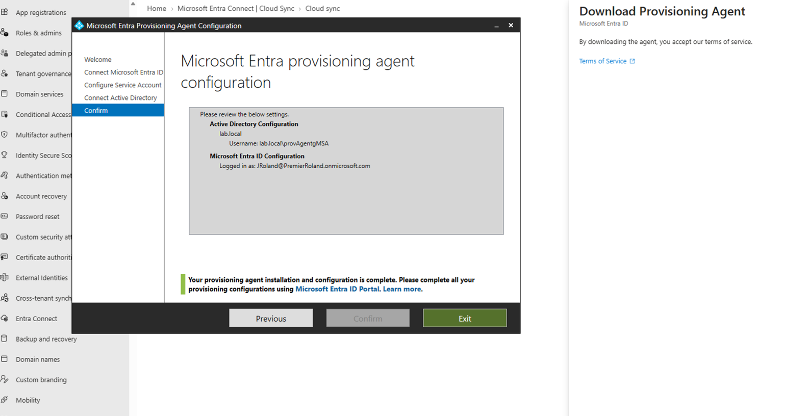
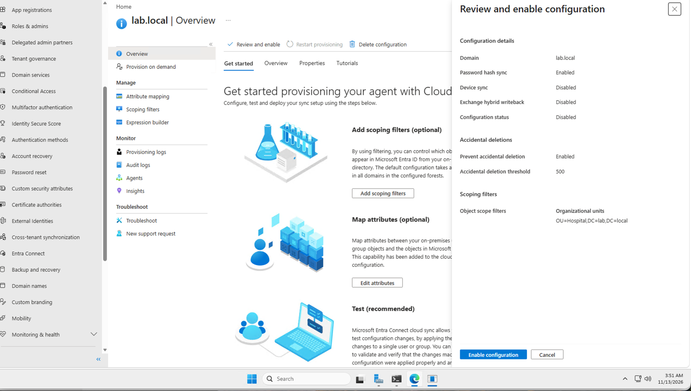
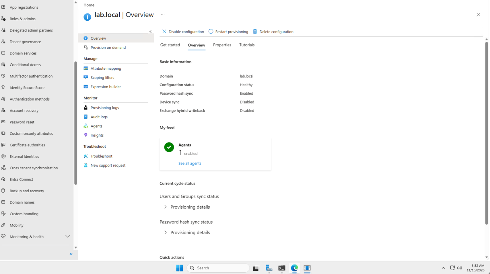
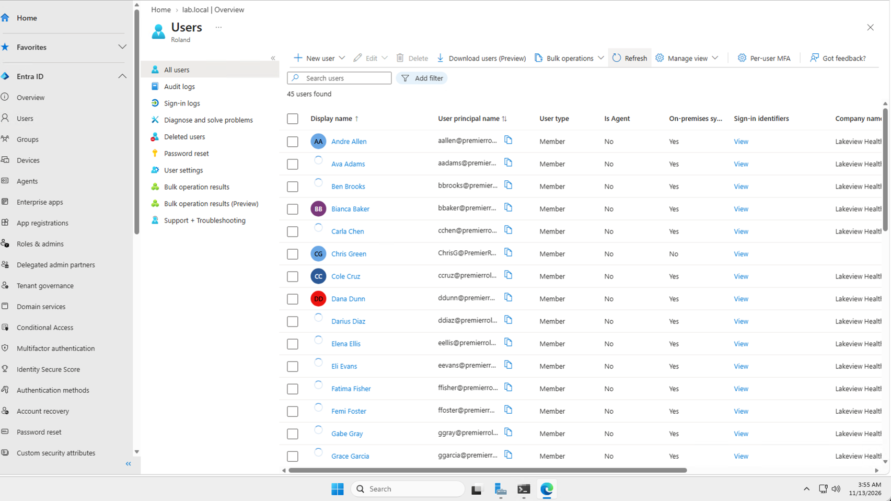

# Hybrid Identity Lab: Active Directory to Entra ID with Cloud Sync

> **Loom walkthrough (5 min):** _link coming soon_

Lab 2 of 5. I connected the on premises `lab.local` forest from [Lab 1](https://github.com/jasonroland-tech/active-directory-lab) to a Microsoft Entra ID tenant with **Entra Cloud Sync**, so Active Directory stays the source of truth and the cloud follows.

## What this proves

| Skill | Evidence |
| --- | --- |
| Hybrid identity | Cloud Sync agent on DC01, AD users provisioned to Entra ID |
| Least privilege service accounts | Agent runs as a gMSA (`provAgentgMSA$`), not a domain admin |
| Scoping | Only `OU=Hospital` syncs; admin and built in accounts stay on premises |
| Authentication | Password hash sync so users sign in to the cloud with their AD password |
| Source of authority | Synced users are read only in Entra; changes are made in AD |

## Architecture

```
DC01 (lab.local)                      Microsoft Entra ID
 ├── OU=Hospital  (40 users) ──┐
 └── Entra provisioning agent  │  Cloud Sync, every ~2 min
     running as LAB\provAgentgMSA$ ──────────────▶  40 users, On-premises sync = Yes
                                       ├── password hash sync
                                       └── scoping filter: OU=Hospital only
```

## How I built it

1. **Created a KDS root key** so AD could create the gMSA (backdated 10 hours, a lab only shortcut).
2. **Installed the provisioning agent** on DC01, signed in with a cloud admin, let it create the gMSA, and connected `lab.local`.
   
3. **Created the configuration** with password hash sync and a scoping filter for `OU=Hospital,DC=lab,DC=local`.
   
4. **Enabled it** and confirmed it was healthy.
   
5. **Verified in Entra:** 40 synced users with department, title and company, alongside 5 cloud only accounts.
   

## Lessons learned

- **gMSA needs a KDS root key.** A brand new domain has none, and a new key normally waits 10 hours before it can be used.
- **Scope on purpose.** Syncing only the Hospital OU keeps the domain admin and built in accounts out of the cloud.
- **AD is the source of authority.** Most fields on a synced user are greyed out in Entra; edit them in AD and let sync carry them up.

The JML test that uses this sync is in [Lab 3](https://github.com/jasonroland-tech/identity-lifecycle-jml-lab).

## Lakeview Health identity lab series

A mock hospital built step by step. Each lab is its own repo with a short Loom walkthrough.

| # | Lab | Focus |
| --- | --- | --- |
| 1 | [active-directory-lab](https://github.com/jasonroland-tech/active-directory-lab) | Active Directory domain in Azure |
| 2 | **hybrid-identity-lab** (this repo) | AD to Entra ID with Cloud Sync |
| 3 | [identity-lifecycle-jml-lab](https://github.com/jasonroland-tech/identity-lifecycle-jml-lab) | Joiner, mover, leaver automation |
| 4 | [entra-conditional-access-lab](https://github.com/jasonroland-tech/entra-conditional-access-lab) | Conditional Access and break glass |
| 5 | [entra-saml-sso-lab](https://github.com/jasonroland-tech/entra-saml-sso-lab) | SAML single sign on |
